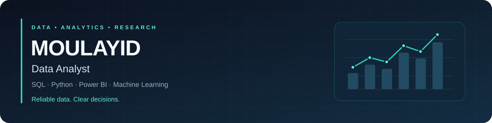
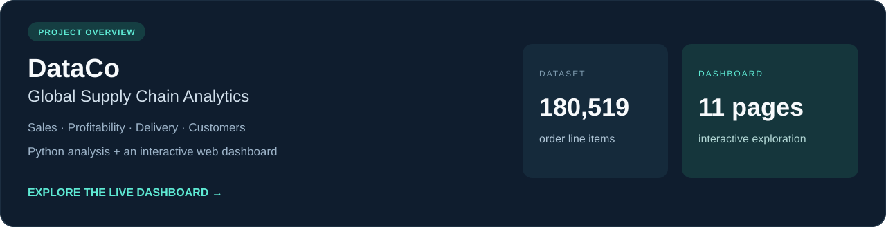

  

  <strong>Data quality · Business intelligence · Analytics engineering</strong> 
  Based in France · Working in French &amp; English

  
  
  

I’m a **Data Analyst** with a Master’s in Data Science and **three years of applied data research at LIMOS, Université Clermont Auvergne**. I turn complex data into reliable KPIs, clear dashboards, and insights that support business decisions.

My background in missing data and probabilistic modelling shapes how I work: **validate the data, test assumptions, and explain the limitations**.

## Selected projects

### 01 / DataCo · Global Supply Chain Analytics

Explore sales, profitability, delivery performance, and customer behaviour through **Python analytics, statistical analysis, machine learning, and an interactive web dashboard**.

**Python · Pandas · scikit-learn · React**

[**Explore dashboard ↗**](https://MOULAYID.github.io/DataCo-Global-Supply-Chain-Analytics/) &nbsp; · &nbsp; [View code](https://github.com/MOULAYID/DataCo-Global-Supply-Chain-Analytics)

---

### 02 / GridPulse · Energy Forecasting & Analytics

An ongoing project focused on **French electricity demand and reliable data**. The roadmap covers public API ingestion, data-quality checks, PostgreSQL analytical models, forecasting, and Power BI reporting.

**Python · PostgreSQL · APIs · Power BI · Time Series**

[**View project & current status ↗**](https://github.com/MOULAYID/gridpulse-energy-forecasting-analytics)

---

### 03 / Research · Data Generation with pyAgrum

Code from my research work involving **Bayesian networks and data generation**, connected to my interests in missing data and probabilistic modelling.

**Python · pyAgrum · Bayesian Networks**

[**Explore research code ↗**](https://github.com/MOULAYID/data_generation_pyAgrum)

## Tools & skills

**Analysis & data preparation**

   

**Business intelligence & pipelines**

   

**Machine learning & research**

   

<strong>More about my research background</strong>

 

At LIMOS, I investigated missing-data mechanisms, probabilistic modelling, and aggregate query processing. My work involved Python pipelines for data generation and simulation, SQL/PostgreSQL experiments, and comparative evaluation of alternative methods.

This experience strengthened my approach to data quality, reproducibility, and communicating technical findings.

## Opportunities

I’m interested in **Data Analyst and Analytics Engineer roles**, remote opportunities, freelance analytics missions, and collaborations involving dashboards, data quality, and useful data products.

**France · French & English · Remote & freelance**

---

  Reliable data. Clear dashboards. Better-informed decisions.

