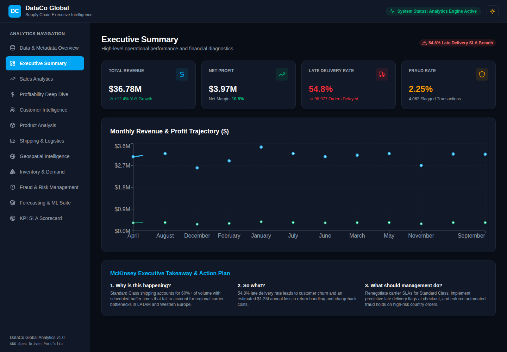
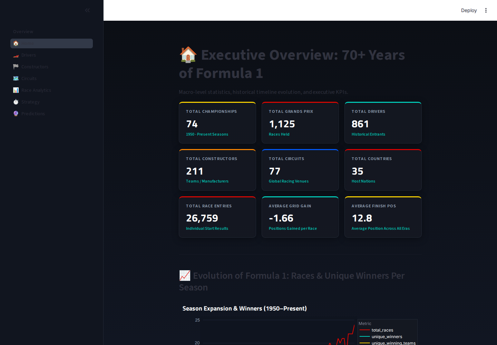
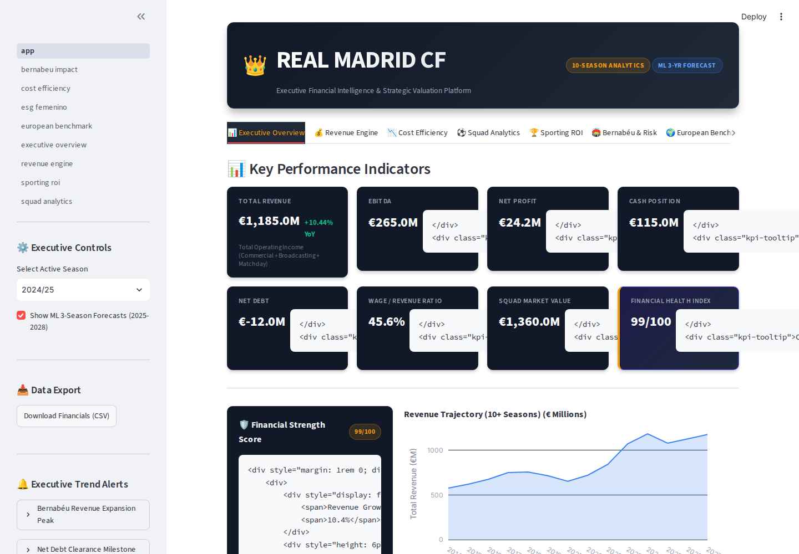

  

  <strong>Data quality · Business intelligence · Analytics engineering</strong> 
  France · French &amp; English · Open to remote roles &amp; freelance missions

  
  
  

I’m a **Data Analyst** with a Master’s in Data Science and **three years of applied data research at LIMOS, Université Clermont Auvergne**. I build Python and SQL workflows, analyse complex datasets, and communicate findings through dashboards.

**My research focus—missing data and probabilistic modelling—shapes how I work: validate the data, test assumptions, and explain limitations.**

## Featured projects

### 01 · DataCo — Supply Chain Analytics

**Business question:** Where do sales, profitability, and delivery performance reveal opportunities for improvement?

<!-- preview:dataco -->

Actual dashboard capture · <a href="https://moulayid.github.io/DataCo-Global-Supply-Chain-Analytics/">Open interactive view ↗</a>

A portfolio project combining Python data preparation, statistical analysis, and machine learning with an interactive dashboard. The dataset contains **180,519 order line items**.

`Python` `Pandas` `scikit-learn` `React`

[**Open dashboard ↗**](https://MOULAYID.github.io/DataCo-Global-Supply-Chain-Analytics/) · [Explore code & methodology](https://github.com/MOULAYID/DataCo-Global-Supply-Chain-Analytics)

---

### 02 · Formula 1 — Performance Intelligence

**Business question:** How do drivers, constructors, circuits, and race strategies compare across Formula 1 history?

<!-- preview:formula1 -->

Actual browser capture of the locally run application · <a href="https://github.com/MOULAYID/Formula-1-World-Championship">View project ↗</a>

A Streamlit analytics project with historical performance comparisons, circuit and strategy analysis, and predictive-modelling experiments.

`Python` `Streamlit` `Plotly` `scikit-learn`

[**Explore project ↗**](https://github.com/MOULAYID/Formula-1-World-Championship) · [Dashboard source](https://github.com/MOULAYID/Formula-1-World-Championship/tree/main/dashboard)

---

### 03 · Real Madrid — Financial Analytics

**Business question:** How do revenue, costs, and squad investment shape a football club’s financial performance?

<!-- preview:realmadrid -->

Actual browser capture of the locally run application · <a href="https://github.com/MOULAYID/real-madrid-analytics">View project ↗</a>

A financial analytics project covering revenue and cost trends, investment scenarios, and club benchmarking, with dashboard, API, and data-pipeline code.

`Python` `Streamlit` `FastAPI` `SQLite`

[**Explore project ↗**](https://github.com/MOULAYID/real-madrid-analytics) · [Analytics notebook](https://github.com/MOULAYID/real-madrid-analytics/blob/main/notebooks/real_madrid_financial_intelligence.ipynb)

## Project catalogue

| Project | Focus |
| :--- | :--- |
| **[GridPulse · Energy Analytics](https://github.com/MOULAYID/gridpulse-energy-forecasting-analytics)** | **In progress.** French electricity demand; roadmap includes API ingestion, quality checks, PostgreSQL, forecasting, and Power BI. |
| **[Incomplete Data Generation · pyAgrum](https://github.com/MOULAYID/data_generation_pyAgrum)** | Bayesian-network simulation of MCAR, MAR, and MNAR missingness; probabilistic databases and distribution-based evaluation. |
| **[Alphagene](https://github.com/MOULAYID/Alphagene)** | Experimental genetic algorithms applied to reinforcement learning. |
| **[NutriScan AI](https://github.com/MOULAYID/AI-Calorie-Tracker)** | AI-assisted meal-photo analysis, food search, nutrition logging, and progress analytics with FastAPI and React. |
| **[Domain Outreach Agent](https://github.com/MOULAYID/domain-outreach-agent)** | Python workflow for lead discovery, draft generation, campaign tracking, and SMTP integration with dry-run support. |

<strong>Earlier work & open-source forks</strong>

- **[Automata with a Simple GUI](https://github.com/MOULAYID/AutomataWithSimpleGui)** — a Java/JavaFX application for defining automata and checking accepted words.
- **[CMU Sphinx](https://github.com/MOULAYID/cmusphinx)** — a fork of the upstream speech-recognition toolkit.

## Tools & skills

**Analysis & data preparation**

   

**Business intelligence & pipelines**

   

**Machine learning & research**

   

## Research background

At **LIMOS**, I investigated missing-data mechanisms, probabilistic modelling, and aggregate query processing. My work involved Python pipelines for data generation and simulation, SQL/PostgreSQL experiments, and comparative evaluation.

That experience connects directly to my interests in **data reliability, reproducible analysis, and useful analytical models**.

## Opportunities

I’m interested in **Data Analyst and Analytics Engineer roles**, remote opportunities, freelance analytics missions, and collaborations on dashboards and data quality.

For now, you can connect with me through **[GitHub](https://github.com/MOULAYID)** or explore **[all my public repositories](https://github.com/MOULAYID?tab=repositories&type=public)**.

---

  Reliable data. Clear dashboards. Better-informed decisions.

