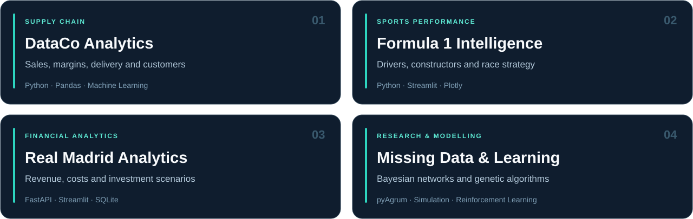

  

  <strong>Data quality · Business intelligence · Analytics engineering</strong> 
  Based in France · Working in French &amp; English

  
  
  

I’m a **Data Analyst** with a Master’s in Data Science and **three years of applied data research at LIMOS, Université Clermont Auvergne**. I turn complex data into reliable KPIs, clear dashboards, and insights that support business decisions.

My background in missing data and probabilistic modelling shapes how I work: **validate the data, test assumptions, and explain the limitations**.

## Selected projects

  

### Business & sports analytics

| Project | What it explores | Main tools |
| :--- | :--- | :--- |
| **[DataCo · Supply Chain Analytics](https://github.com/MOULAYID/DataCo-Global-Supply-Chain-Analytics)** | Sales, profitability, delivery performance, and customer behaviour across 180,519 order line items. [Interactive dashboard ↗](https://MOULAYID.github.io/DataCo-Global-Supply-Chain-Analytics/) | Python · Pandas · scikit-learn · React |
| **[Formula 1 · Performance Intelligence](https://github.com/MOULAYID/Formula-1-World-Championship)** | Historical driver and constructor performance, circuit dynamics, race strategy, prediction, and clustering. | Python · Streamlit · Plotly · scikit-learn |
| **[Real Madrid · Financial Analytics](https://github.com/MOULAYID/real-madrid-analytics)** | Revenue, costs, squad investment, financial scenarios, and club benchmarking through a dashboard and API. | Python · Streamlit · FastAPI · SQLite |

### Data engineering & research

| Project | Focus | Main tools |
| :--- | :--- | :--- |
| **[GridPulse · Energy Forecasting & Analytics](https://github.com/MOULAYID/gridpulse-energy-forecasting-analytics)** | **In progress.** French electricity demand; roadmap covers API ingestion, data validation, analytical models, forecasting, and Power BI reporting. | Python · PostgreSQL · APIs · Power BI |
| **[Incomplete Data Generation with pyAgrum](https://github.com/MOULAYID/data_generation_pyAgrum)** | Synthetic complete and incomplete datasets under MCAR, MAR, and MNAR mechanisms, probabilistic databases, and distribution-based evaluation. | Python · pyAgrum · PostgreSQL |
| **[Alphagene · Genetic Algorithms & Reinforcement Learning](https://github.com/MOULAYID/Alphagene)** | An experimental project applying genetic algorithms to reinforcement learning, with agent and model code. | Python · Genetic Algorithms · Reinforcement Learning |

### Applied AI & automation

| Project | What it does | Main tools |
| :--- | :--- | :--- |
| **[NutriScan AI · Calorie & Nutrition Tracker](https://github.com/MOULAYID/AI-Calorie-Tracker)** | A nutrition-tracking application with AI-assisted meal-photo analysis, food search, meal logging, recipes, and progress analytics. | FastAPI · React · Gemini Vision · SQLite |
| **[Domain Outreach Agent](https://github.com/MOULAYID/domain-outreach-agent)** | A workflow for domain imports, lead discovery, draft generation, campaign-state tracking, and SMTP integration, with a dry-run mode. | Python · Streamlit · SQLite · APIs |

<strong>Earlier work & other public repositories</strong>

 

- **[Automata with a Simple GUI](https://github.com/MOULAYID/AutomataWithSimpleGui)** — a Java/JavaFX application for defining automata and checking whether input words are accepted.
- **[CMU Sphinx](https://github.com/MOULAYID/cmusphinx)** — a fork of the upstream speech-recognition toolkit.

[Browse all public repositories ↗](https://github.com/MOULAYID?tab=repositories&type=public)

## Tools & skills

**Analysis & data preparation**

   

**Business intelligence & pipelines**

   

**Machine learning & research**

   

<strong>More about my research background</strong>

 

At LIMOS, I investigated missing-data mechanisms, probabilistic modelling, and aggregate query processing. My work involved Python pipelines for data generation and simulation, SQL/PostgreSQL experiments, and comparative evaluation of alternative methods.

This experience strengthened my approach to data quality, reproducibility, and communicating technical findings.

## Opportunities

I’m interested in **Data Analyst and Analytics Engineer roles**, remote opportunities, freelance analytics missions, and collaborations involving dashboards, data quality, and useful data products.

**France · French & English · Remote & freelance**

---

  Reliable data. Clear dashboards. Better-informed decisions.

